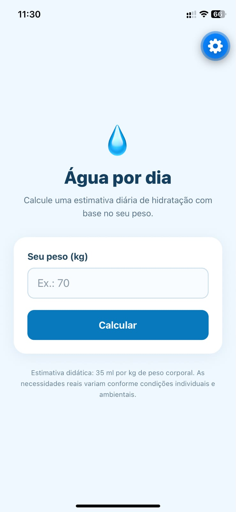
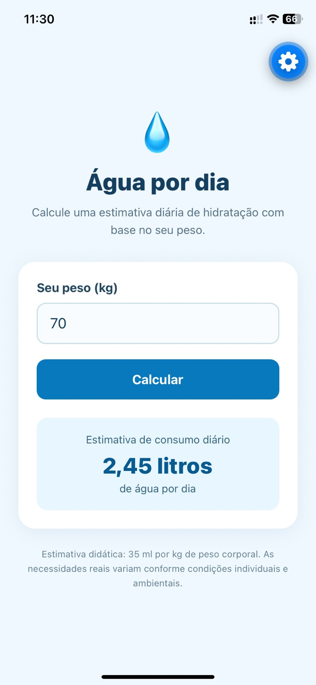
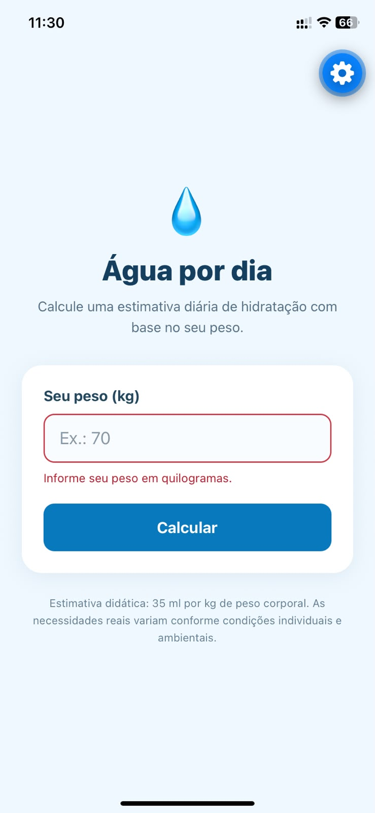
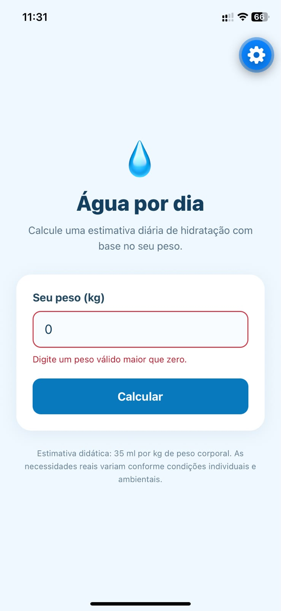

# Questão 1 — Consumo diário de água 💧

Aplicativo **mobile** independente, desenvolvido em **React Native com Expo**, para estimar didaticamente a quantidade diária de água com base no peso corporal.

## Enunciado
Receber o peso em quilogramas e calcular o consumo diário estimado de água, considerando **35 ml por kg**.

**Fórmula:** `litros = (pesoEmKg * 35) / 1000`

**Exemplo:** 70 kg → **2,45 litros por dia**.

## Funcionalidades
- Campo de peso em kg, com teclado numérico;
- Botão **Calcular**;
- Resultado em litros, com duas casas decimais e vírgula decimal;
- Mensagens de erro para campo vazio, zero, número negativo e entrada inválida;
- Aceita vírgula ou ponto como separador decimal;
- Limpa resultados anteriores quando o peso é alterado;
- Interface adaptada para celular.

## Tecnologias
React Native, Expo, JavaScript, `View`, `Text`, `TextInput`, `Pressable`, `StyleSheet` e `useState`.

## Capturas de tela

### 1. Tela inicial
Captura com campo de peso vazio e botão **Calcular**.

### 2. Cálculo realizado
Captura com peso **70** e resultado **2,45 litros**.

### 3. Validação do campo vazio
Captura após pressionar **Calcular** sem preencher o peso.

### 4. Validação de peso inválido
Captura com peso **0** (ou negativo) e a mensagem de erro.

