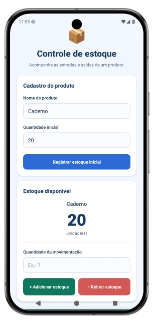
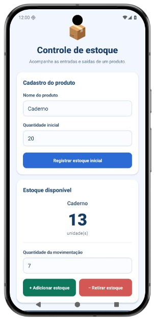
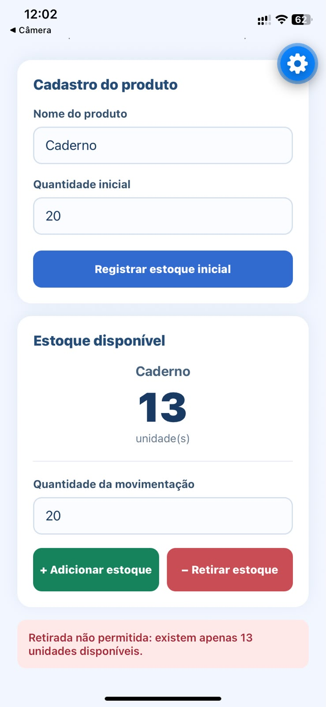
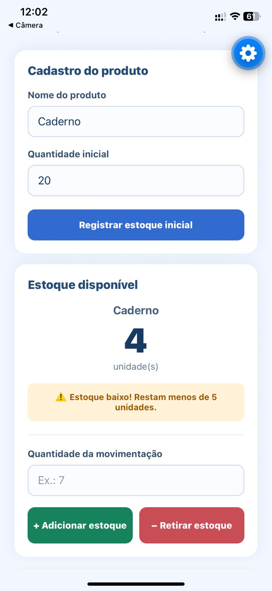

# Questão 3 — Controle de estoque 📦

Aplicativo **mobile** independente, desenvolvido em **React Native com Expo**, para acompanhar a quantidade disponível de um produto por meio de entradas e saídas.

## Enunciado
Receber o nome do produto, sua quantidade inicial e uma quantidade de movimentação. Permitir **Adicionar estoque** e **Retirar estoque**, impedindo retiradas superiores ao disponível e exibindo um alerta quando restarem menos de cinco unidades.

**Exemplo:** 20 unidades − 7 unidades → **13 unidades disponíveis**.

## Funcionalidades
- Campo para nome do produto;
- Campo para quantidade inicial e botão para registrar o estoque;
- Campo para quantidade de movimentação;
- Botões **Adicionar estoque** e **Retirar estoque**;
- Atualização imediata da quantidade disponível;
- Impede retirada maior que o estoque;
- Alerta de estoque baixo quando restarem 0 a 4 unidades;
- Validação de campos vazios, números negativos, decimais e valores inválidos;
- Interface adaptada para celular.

## Tecnologias
React Native, Expo, JavaScript, `View`, `Text`, `TextInput`, `Pressable`, `StyleSheet` e `useState`.

## Capturas de tela

### 1. Estoque inicial
Captura com produto **Caderno** e **20 unidades** cadastradas.

### 2. Retirada realizada
Captura após retirar **7 unidades**, exibindo **13 unidades disponíveis**.

### 3. Retirada superior ao disponível
Captura da tentativa de retirar mais unidades do que o estoque permite, com mensagem de erro.

### 4. Alerta de estoque baixo
Captura com **4 unidades** ou menos e alerta de estoque baixo.

