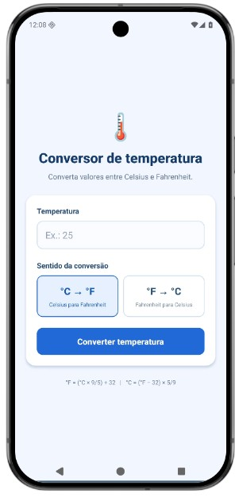
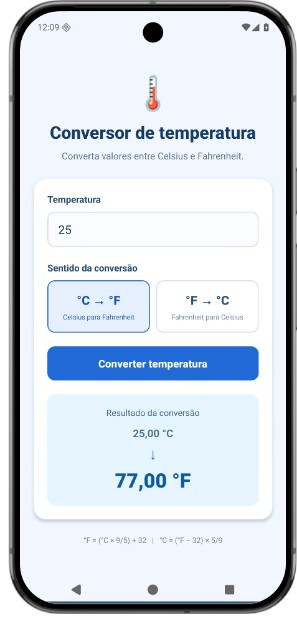
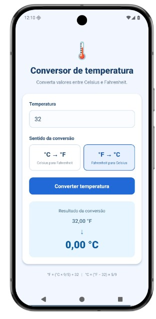

# Questão 4 — Conversor de temperatura 🌡️

Aplicativo **mobile** independente, desenvolvido em **React Native com Expo**, para converter temperaturas entre Celsius e Fahrenheit.

## Enunciado
Receber uma temperatura numérica, permitir a seleção do sentido da conversão e apresentar o resultado após pressionar o botão.

**Celsius para Fahrenheit:** `°F = (°C × 9/5) + 32`

**Fahrenheit para Celsius:** `°C = (°F − 32) × 5/9`

**Exemplo:** 25 °C → **77 °F**.

## Funcionalidades
- Campo numérico para temperatura;
- Seleção entre **Celsius → Fahrenheit** e **Fahrenheit → Celsius**;
- Botão **Converter temperatura**;
- Exibição do valor original e do resultado com duas casas decimais;
- Aceita números negativos, vírgula e ponto decimal;
- Validação de campos vazios e valores inválidos;
- Limpa o resultado quando a temperatura ou o sentido é alterado;
- Interface adaptada para celular.

## Tecnologias
React Native, Expo, JavaScript, `View`, `Text`, `TextInput`, `Pressable`, `StyleSheet` e `useState`.

## Capturas de tela

### 1. Tela inicial
Captura com o campo vazio e a opção **°C → °F** selecionada.

### 2. Celsius para Fahrenheit
Captura com **25 °C**, exibindo **77,00 °F**.

### 3. Fahrenheit para Celsius
Captura com **32 °F**, exibindo **0,00 °C**.

### 4. Validação de entrada
Captura após tentar converter com o campo vazio ou valor inválido.

