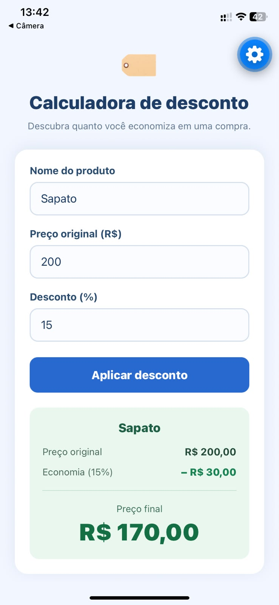
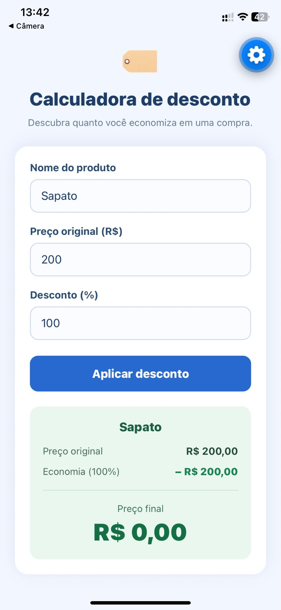

# Questão 7 — Calculadora de desconto 🏷️

Aplicativo **mobile** independente, desenvolvido em **React Native com Expo**, para calcular a economia e o preço final de um produto após a aplicação de um desconto percentual.

## Enunciado
Receber o **nome do produto**, **preço original** e **percentual de desconto**. Ao pressionar **Aplicar desconto**, mostrar a economia e o preço final. Validar preço não negativo e desconto entre **0% e 100%**.

**Fórmulas:**
- `economia = preço original × percentual / 100`
- `preço final = preço original − economia`

**Exemplo:** R$ 200,00 com 15% de desconto → economia de **R$ 30,00** e preço final de **R$ 170,00**.

## Funcionalidades
- Campo para nome do produto;
- Campo para preço original em reais;
- Campo para percentual de desconto;
- Botão **Aplicar desconto**;
- Exibição do produto, preço original, economia e preço final;
- Validação de nome vazio, preço negativo e desconto fora de 0% a 100%;
- Aceita preço igual a zero e desconto igual a 0% ou 100%;
- Aceita vírgula ou ponto como separador decimal, com até duas casas;
- Limpa o resultado quando algum campo é alterado;
- Interface adaptada para celular.

## Tecnologias
React Native, Expo, JavaScript, `View`, `Text`, `TextInput`, `Pressable`, `StyleSheet` e `useState`.

## Capturas de tela

### 1. Tela inicial
Captura com os campos vazios e o botão **Aplicar desconto**.

### 2. Desconto aplicado
Captura com produto de **R$ 200,00** e desconto de **15%**, exibindo economia de **R$ 30,00** e preço final de **R$ 170,00**.

### 3. Desconto de 100%
Captura com desconto de **100%**, exibindo preço final de **R$ 0,00**.

### 4. Validação de desconto inválido
Captura com desconto de **110%** ou preço negativo, mostrando mensagem de erro.

