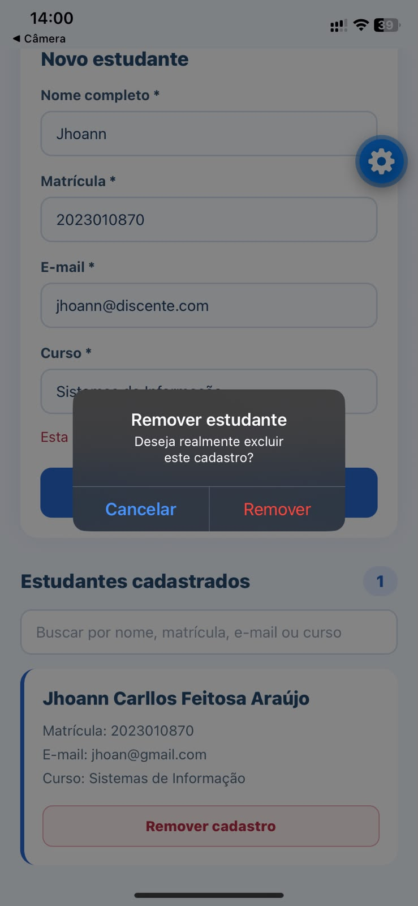

# Questão 8 — Cadastro de estudantes 🎓

Aplicativo **mobile** independente, desenvolvido em **React Native com Expo**, para cadastrar, consultar, pesquisar e remover estudantes.

## Enunciado
Criar um formulário com **nome**, **matrícula**, **e-mail** e **curso**. Ao cadastrar, construir um objeto e adicioná-lo a um array de estudantes. Exibir os registros em cards usando `map()`, impedir matrícula duplicada, validar os campos obrigatórios e permitir a remoção.

**Exemplo de cadastro:**
```js
{
  nome: "Maria Silva",
  matricula: "20260001",
  email: "maria@exemplo.com",
  curso: "Licenciatura em Computação"
}
```

## Funcionalidades
- Cadastro de estudantes com quatro campos obrigatórios;
- Validação de campos vazios e formato básico do e-mail;
- Bloqueio de matrícula duplicada;
- Armazenamento dos objetos em array com `useState`;
- Exibição dos registros em cards usando `map()`;
- Busca por nome, matrícula, e-mail ou curso;
- Remoção de cadastro com confirmação;
- Contador de estudantes cadastrados;
- Interface adaptada para celular.

## Tecnologias
React Native, Expo, JavaScript, `View`, `Text`, `TextInput`, `Pressable`, `StyleSheet`, `useState`, `map()` e `filter()`.

## Capturas de tela

### 1. Tela inicial
Formulário vazio e lista sem estudantes.


### 2. Estudante cadastrado
Cadastro de Jhoann, matrícula **2023010870**.


### 3. Matrícula duplicada
Tentativa de cadastrar novamente a matrícula **2023010870**, mostrando erro.


### 4. Remoção
Confirmação ao remover um cadastro.


