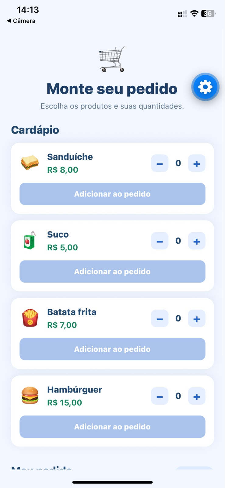
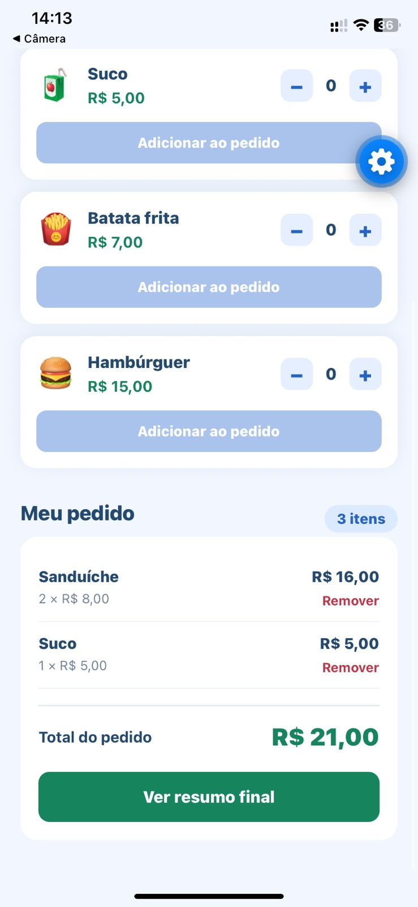
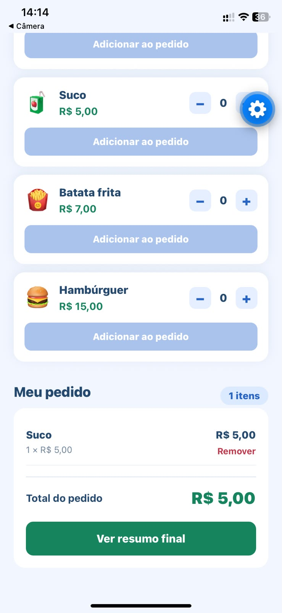
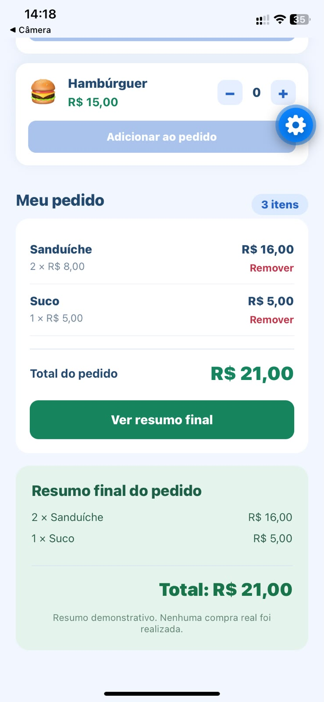

# Questão 9 — Montagem de pedidos 🛒

Aplicativo **mobile** independente, desenvolvido em **React Native com Expo**, para selecionar produtos, definir quantidades e montar pedidos.

## Enunciado
Disponibilizar pelo menos quatro produtos com nome e preço, permitir seleção de quantidade, adicionar itens como objetos em um array, calcular subtotais e total, remover itens e apresentar um resumo final.

**Exemplo:** 2 sanduíches de R$ 8,00 + 1 suco de R$ 5,00 = **R$ 21,00**.

## Produtos
| Produto | Preço |
|---|---:|
| Sanduíche | R$ 8,00 |
| Suco | R$ 5,00 |
| Batata frita | R$ 7,00 |
| Hambúrguer | R$ 15,00 |

## Funcionalidades
- Cardápio com quatro produtos;
- Botões `+` e `−` para selecionar a quantidade (de 0 a 99);
- Botão para adicionar ao pedido;
- Itens armazenados como objetos em array com `useState`;
- Soma da quantidade quando o mesmo produto é adicionado novamente;
- Subtotal por produto (`preço × quantidade`);
- Total do pedido calculado automaticamente;
- Remoção de produtos do pedido;
- Botão **Ver resumo final**, com detalhamento dos itens e total;
- Valores monetários calculados em centavos;
- Interface adaptada para celular.

## Tecnologias
React Native, Expo, JavaScript, `View`, `Text`, `Pressable`, `StyleSheet`, `useState`, `map()`, `filter()` e `reduce()`.

## Capturas de tela

### 1. Tela inicial
Cardápio com os quatro produtos e pedido vazio.

### 2. Produtos adicionados
Dois sanduíches e um suco adicionados ao pedido, totalizando **R$ 21,00**.

### 3. Resumo final
Resumo com quantidade, nome, subtotal de cada produto e total de **R$ 21,00**.

### 4. Remoção de item
Remoção do suco e atualização do total para **R$ 16,00**.

